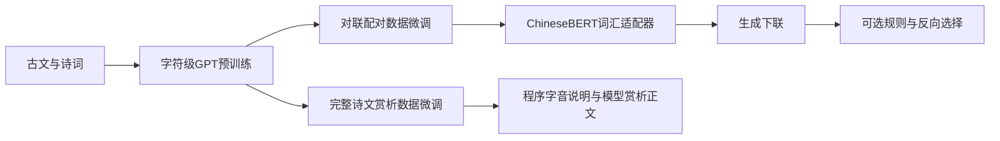

# 方法：一个预训练底座，两项下游任务

本项目围绕同一个字符级GPT底座开展两项工作：对联生成和古诗文赏析。两项任务分别微调，使用不同的最终权重；赏析模型没有接收对联生成器的隐藏状态或ChineseBERT特征。

## 整体流程

## 预训练底座

使用自己实现的Decoder-only GPT：6层、256维、4个注意力头、Pre-LN、GELU，可学习位置嵌入，输入输出共享字符嵌入。原词表13232，上下文128，参数8154624。汉字向量随语言建模损失共同学习，没有使用对比学习嵌入。

古文和诗词进行规范化、清洗与划分，再构建字符级下一Token训练样本。正文预算约3000万Token；唐诗、宋诗、词、古文的目标采样比例为30%／30%／10%／30%，按平均窗口正文长度修正采样概率。原始数据来源与许可见 [第三方声明](../THIRD_PARTY_NOTICES.md)。

对应代码：[GPT骨干](../couplet_gpt/modeling/gpt.py)、[数据与字符表](../couplet_gpt/data/datasets.py)、[预训练](../couplet_gpt/training/pretrain.py)。

## 任务一：对联生成

训练输入以特殊Token分隔上联与下联，用上联预测下联。最终模型保留字符级GPT、字位对齐以及词汇适配器；前向和反向模型各34759428参数。

词汇分支在条件句中匹配最终词库。每个词的表示由冻结ChineseBERT对应字符跨度的上下文特征和可学习词组残差组成；字符状态作为查询，通过双线性注意力选择匹配词，再将词汇增量注入自建GPT。ChineseBERT只编码当前条件句，前向输入上联，反向输入候选下联，不编码该方向的目标答案。

这里借鉴 **ChineseBERT** 的字形、拼音与上下文表示，以及 **LEBERT** 的字符到词汇双线性注意力融合。适配器位于自建GPT中，并非在ChineseBERT内部完整复现LEBERT。相关论文和实现差异见 [课程报告](../reports/project_report.pdf) 的方法与参考文献。

曾参照COLING 2022尝试词性与依存注意力注入，但没有观察到稳定生成收益，因此最终模型不包含该语法分支；字位对齐也不能被记作该分支的贡献。典故检索生成路线已经放弃，旧实验保留在本地归档。

对应代码：[最终对联模型](../couplet_gpt/modeling/couplet.py)、[词汇适配器](../couplet_gpt/modeling/lexical_adapter.py)、[ChineseBERT](../couplet_gpt/modeling/chinesebert.py)、[前向训练](../couplet_gpt/training/couplet.py)、[反向训练](../couplet_gpt/training/reverse.py)。

### 两种推理模式

|模式|搜索|外部对联规则|选择分数|
|---|---|---|---|
|`rules`|beam16＋8条采样|等长、汉字、同位避字、重复模式、句脚音类|F＋0.25R，或仅F|
|`unconstrained`|相同搜索宽度与采样条数|仅禁止正文出现控制Token；EOS自然停止|相同选择分数|

F为平均正向对数概率，R为平均反向对数概率，均包含EOS。反向模型负责判断候选下联能否解释上联，不负责提供参考答案。`--forward-only`使反向分数不参与选择，仍保留beam与采样。

有规则模式通过掩码将违规Token分数置为负无穷。无规则模式不强制等长，不按结构或平仄过滤候选，最多63个新Token；触顶会报告截断。模型输入容量限制每联最多62个汉字，支持接收输入不等于该长度质量已充分验证。

检查器只给出可核对的结构与现代音代理，不能证明词性相对、句法成立、语义贴切或完整传统联律成立。

## 任务二：古诗文赏析

从原始预训练底座直接微调完整赏析。扩展词表至15829、位置表至1536，参数9179904；新增字符和位置随机初始化。训练798397条样本，完整遍历一轮，监督221304997个正文与EOS Token。没有对联专项适配，也没有ChineseBERT词汇分支。

输入包含完整原文、任务提示与程序生成的字音依据。损失只监督赏析正文和EOS。程序字音首句与模型生成正文分别返回，正文指标不把程序首句计入模型成果。平水韵字表只表示字表音类，不能代替语境消歧或完整格律认证。

对应代码：[数据构建](../couplet_gpt/data/build_appreciation.py)、[赏析训练](../couplet_gpt/training/appreciation.py)、[正文生成](../couplet_gpt/training/appreciation_runtime.py)、[字音说明](../couplet_gpt/resources/prosody_annotation.py)。

## 如何阅读代码

先看 [统一入口](../couplet_gpt/inference/cli.py)，再按任务进入模型或训练模块。`modeling/`管理张量计算，`data/`管理数据与特征，`training/`管理训练，`inference/`管理推理，`evaluation/`管理实验与指标，`resources/`管理规则及词典。目录名表达功能，历史版本对应关系只保留在本地迁移记录中。
